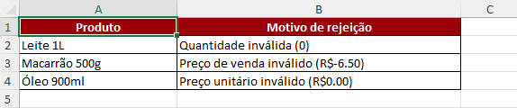

# Controle de Vendas e Lucro | Automação com Python e Excel

Sistema desenvolvido em Python para automatizar cálculos financeiros, importar dados de vendas e gerar relatórios em Excel, facilitando o acompanhamento dos resultados de um negócio.

## Objetivo do projeto

Demonstrar como a automação pode simplificar o controle de vendas, reduzir cálculos manuais e organizar informações financeiras em relatórios.

O sistema permite importar produtos diretamente de uma planilha Excel, calcular faturamento, custos, lucro bruto e margem de lucro, além de identificar registros inválidos.

## Aplicações para empresas

- Controle de faturamento e custos de produtos.
- Acompanhamento de lucro e margem de lucro.
- Automatização de relatórios comerciais.
- Identificação de inconsistências em planilhas.
- Organização de informações para análise de resultados.

## Funcionalidades

- Importação de vendas a partir de arquivos Excel (.xlsx).
- Cálculo de faturamento por produto.
- Cálculo de custo total e lucro bruto.
- Cálculo de margem de lucro individual e geral.
- Validação de quantidades e preços menores ou iguais a zero.
- Resumo consolidado das vendas.
- Geração automática de relatórios em Excel.
- Formatação de cabeçalhos, valores monetários, percentuais e bordas.
- Criação de uma aba específica para registros rejeitados, informando os motivos.

## Tecnologias utilizadas

- Python
- openpyxl
- Microsoft Excel
- Git e GitHub

## Como executar

1. Clone o repositório:

   `git clone https://github.com/davisalves38-lab/controle-vendas-lucro-python.git`

2. Acesse a pasta do projeto:

   `cd controle-vendas-lucro-python`

3. Instale as dependências:

   `python -m pip install -r requirements.txt`

4. Abra o arquivo `exemplos/vendas.xlsx` e preencha os dados de vendas, respeitando a estrutura das colunas:

   - Produto
   - Quantidade
   - Preço de Custo
   - Preço de Venda

5. Execute o programa:

   `python main.py`

6. Consulte o arquivo `exemplos/relatorio_vendas.xlsx`, gerado automaticamente.

## Estrutura do projeto

- `main.py`: processamento das vendas, validação dos dados e geração do relatório.
- `calcular.py`: funções de cálculos financeiros.
- `formatacao.py`: configurações visuais do Excel.
- `ler_vendas.py`: leitura e importação dos dados da planilha.
- `requirements.txt`: dependências do projeto.
- `exemplos/vendas.xlsx`: planilha demonstrativa de entrada.
- `exemplos/relatorio_vendas.xlsx`: relatório financeiro gerado.
- `imagens/relatorio.png`: imagem demonstrativa do relatório.

## Relatórios gerados

**Relatório de Vendas**

Apresenta os produtos válidos, quantidades vendidas, faturamento, custos, lucro bruto e margem de lucro, incluindo um resumo financeiro consolidado.

**Registros Rejeitados**

Apresenta os produtos que não passaram pelas validações, indicando o motivo da rejeição.

Atualmente, o sistema verifica quantidades e preços menores ou iguais a zero. Validações de células vazias e valores não numéricos estão previstas para futuras versões.

## Exemplos dos relatórios gerados

### Relatório de Vendas

### Registros Rejeitados

## Observações

Os produtos e valores utilizados são fictícios e destinados à demonstração do funcionamento do sistema.

O projeto foi desenvolvido para fins de aprendizado, portfólio profissional e demonstração de soluções de automação com Python e Excel.

## Autor

**David de Brito Alves**

Estudante de Análise e Desenvolvimento de Sistemas, com interesse em desenvolvimento de software, automação de processos e análise de dados.