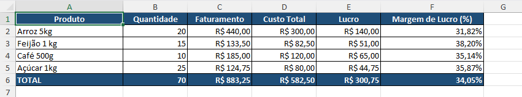

# Controle de Vendas e Lucro

Sistema desenvolvido em Python para automatizar cálculos de vendas, custos, lucro bruto e margem de lucro, com geração de relatórios em Excel.

## Funcionalidades

- Cálculo de faturamento por produto
- Cálculo de custo total e lucro bruto
- Cálculo de margem de lucro individual e geral
- Validação de quantidades e preços inválidos
- Resumo consolidado das vendas
- Geração automática de relatórios em Excel
- Formatação de cabeçalhos, valores monetários, percentuais e bordas

## Tecnologias utilizadas

- Python
- OpenPyXL
- Git e GitHub

## Como executar

1. Clone o repositório.
2. Instale as dependências:

   `python -m pip install -r requirements.txt`

3. Execute o programa:

   `python main.py`

4. Consulte o relatório gerado na pasta `exemplos`.

## Estrutura do projeto

- `main.py`: processamento das vendas e geração do relatório
- `calcular.py`: funções de cálculos financeiros
- `formatacao.py`: configurações visuais do Excel
- `requirements.txt`: dependências do projeto
- `exemplos/`: relatório demonstrativo

## Observações

Os produtos e valores utilizados são fictícios e destinados à demonstração do funcionamento do sistema.

## Exemplo do relatório gerado

## Autor

David de Brito Alves

Estudante de Análise e Desenvolvimento de Sistemas.